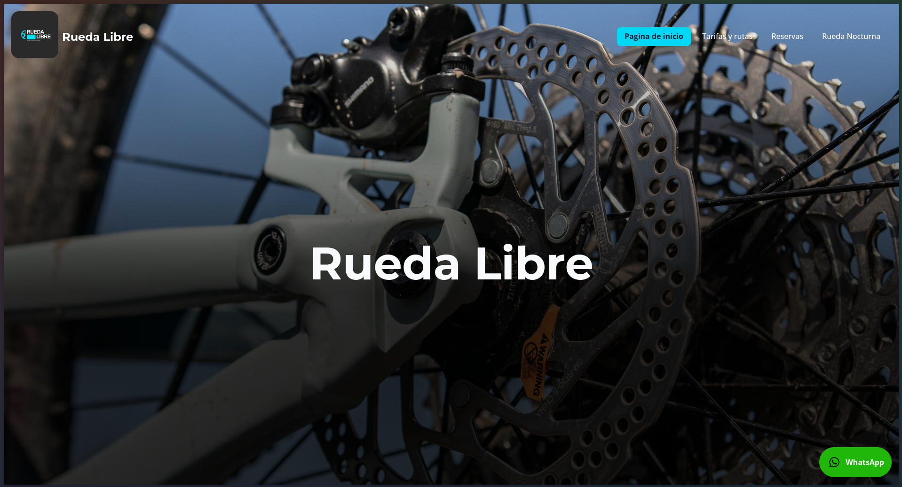
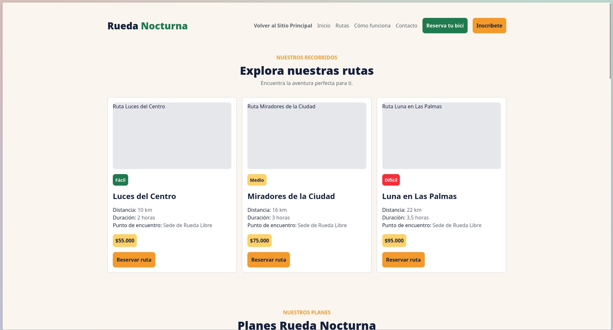
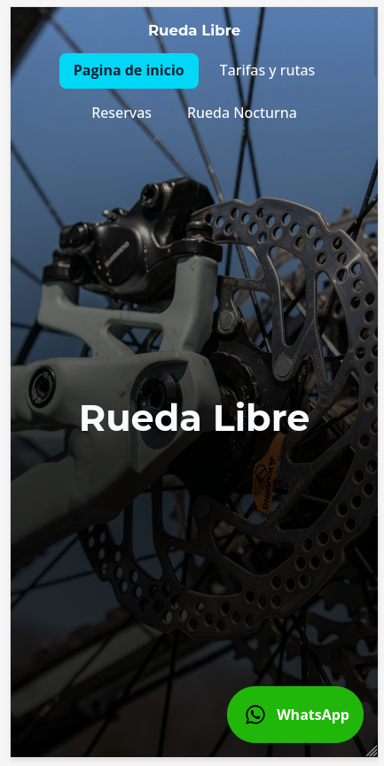
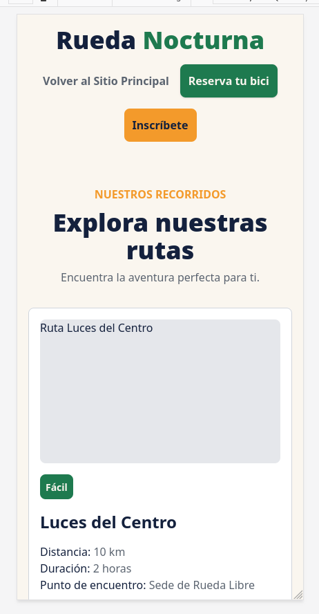
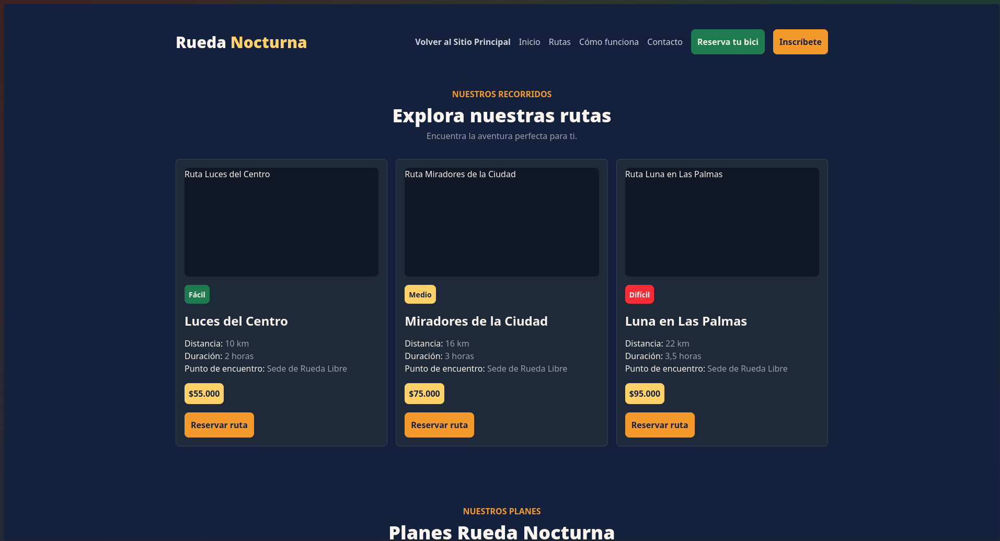

# Rueda Libre & Rueda Nocturna — Proyecto Integrador

## 🚴 Descripción del Proyecto
**Rueda Libre** es un emprendimiento local de la ciudad de Medellín dedicado al alquiler de bicicletas y la organización de recorridos guiados por la ciudad. Este repositorio alberga el ecosistema web consolidado que incluye el sitio principal de la marca (desarrollado con HTML semántico, CSS nativo y refinado con Bootstrap v5) y la landing page de la campaña **Rueda Nocturna** (desarrollada con Tailwind CSS v4, kit de marca personalizado, modo oscuro nativo y sistema de reserva de rutas).

---

## 🔗 Enlaces Publicados y Despliegue
* **Sitio Principal (GitHub Pages):** [https://daptian.github.io/modulo-html-css/index.html](https://daptian.github.io/modulo-html-css/index.html)
* **Sitio de prueba de boostrap:** [https://daptian.github.io/modulo-html-css/pruebas/catalogo-bootstrap.html](https://daptian.github.io/modulo-html-css/pruebas/catalogo-bootstrap.html)
* **Landing Rueda Nocturna (GitHub Pages):** [https://daptian.github.io/modulo-html-css/nocturna/index.html](https://daptian.github.io/modulo-html-css/nocturna/index.html)
* **Repositorio en GitHub:** [https://github.com/daptian/modulo-html-css](https://github.com/daptian/modulo-html-css)

---

## 📄 Páginas del Ecosistema
1. **`index.html`** — Página de inicio del sitio principal (Quienes somos, servicios, flota y rutas).
2. **`paginas/tarifas.html`** — Tarifas detalladas y recorridos por Medellín.
3. **`paginas/reservas.html`** — Formulario principal de reservas de bicicletas.
4. **`nocturna/index.html`** — Landing page de la campaña especial "Rueda Nocturna" (Rutas, Planes, Formulario de inscripción y kit de diseño con modo claro/oscuro).
5. **`componentes.html`** — Kit de componentes UI de la marca.

---

## 🛠️ Tecnologías Utilizadas
* **HTML5:** Marcado semántico, formularios validados nativamente y accesibilidad con teclado.
* **CSS3:** Flexbox, CSS Grid, variables custom (`var(--*)`) y diseño responsive con `clamp()`.
* **Bootstrap v5:** Componentes de Grid y Tarjetas para distribución eficiente de pruebas
* **Tailwind CSS v3 y un poco de la 4 :/ :** Desarrollo utility-first con directiva `@theme`, componentes con `@apply`, purga JIT y minificación `--minify`.
* **Google Fonts:** Montserrat (títulos/encabezados) y Open Sans (cuerpos de texto).
* **DevTools (Chrome/Firefox):** Redes (Network), inspección de Computed (Box Model) y emulación de medios (`prefers-color-scheme`).

---

## 🖼️ Capturas de Pantalla (Evidencia de Diseño)

### 1. Vista en Escritorio (Desktop)


## 1.1 Nocturna



### 2. Vista Móvil (360px - Mobile First)





### 3. Modo Oscuro (Dark Mode - Prefers Color Scheme)


---

## 📝 Bitácora de Desarrollo Completa

```txt
Reto Dia 1 

NetWork DevTools

(4)
URL completa = http://127.0.0.1:3000/modulo-html-css/rueda-libre/index.html 
El puerto = 3000
El protocolo = http
El host = 127.0.0.1
La ruta = modulo-html-css/rueda-libre/index.html
Metodo de peticion = GET
Codigo de estado = 200 OK 

-
(5)
Al hacer la peticion a http://127.0.0.1:3000/modulo-html-css/rueda-libre/promociones.html
Sale un codigo de estado de 404 NOT FOUND
El Servidor no puedo encontrar la direccion solicitada, por eso el error 404
En la Web sale lo siguiente:

File not found
The file "/home/datian/RIWI/modulo-html-css/rueda-libre/promociones.html" cannot be found. It may have been moved, edited, or deleted.

-
(6)
Rol de HTML 
-HTML será el encargado de estruturar el cuerpo y la información de la pagina, agregando titulos,descripciones, imagenes, links, y entre otras caracteristicas que van a componer a la web de Rueda Libre
* HTML sera usado para mostrar los enlaces de navegación de la pagina, menus, enlaces relativos y externos como un chat por WhatsApp 

Rol de CSS
-CSS sera el encargado de darle color y estilado a la estrutura previamente creada con HTML
* CSS será usado para estilizar formularios, encabezados, textos, enlaces imagenes y todo lo que hace llamativa a una web

Rol de JavaScript 
-JavaScript será usado para darle accion y dinamismo a los elementos previamente creados con HTML
* JavaScript ayudara al sitio de Rueda Libre a crear un sitio dinamico, funcional, responsivo a peticiones del usuario y manejara el comportamiento de ciertos elementos en la web

Rueda Libre v0.1:
Registro de rutas usadas en la web navegable para la v0.1

ARCHIVO DE ORGIEN | DESTINO         | RUTA ESCRITA
|_________________|_________________|_____________________
index.html        | tarfias.html    | ./paginas/tarifas.html
index.html        | reservas.html   | ./paginas/reservas.html
tarifas.html      | index.html      | ../index.html
tarifas.html      | reservas.html   | ./reservas.html
reservas.html     | index.html      | ../index.html
reservas.html     | tarifas.html    | ./tarifas.html


Reto Dia 2

-
[5](5)
Justificación de <span>

-Etiqueta span por contendio equivalente
<span><a href="mailto:hola@ruedalibre.example"> Enlace de contacto por correo</a></span>

-
[7](3)
Tabla de registro pruebas de validación <input> *.html

CAMPO                          | DATO DE PRUEBA | RESULTADO ESPERADO                                  | RESULTADO OBTENIDO
<input> name -> 'nombre'       | 'Lu'           | Error de validación por cantidad de caracteres      | Error de validación por cantidad de caracteres ("Ingresa como minimo 3 caracteres")
<input> name -> 'cedula'       | 'AbgIlM'       | Formato invalido por ingresar letras                | Formato invalido, solo caracteres numericos ("Ingresa solo números (entre 6 y 10 dígitos)")
<input> name -> 'cedula'       | 12340          | Error de validación por no cumplir con minimo 6 dig.| Formato invalido, solo caracteres numericos ("Ingresa solo números (entre 6 y 10 dígitos)")
<input> name -> 'correo'       | 'hola.com      | Formato invalido por no ser convencional('email')   |Formato invalido (Incluye un signo '@' en la direccion de correo electronica)
<input> name -> 'telefeno'     | 1234567890     | Formato invalido por no empezar con el numero 3     | Formato invalido ("Ingresa solo 10 digitos y tu numero debe empezar por 3")
<input> name -> 'telefeno'     | 300123         | Formato invalido por no tener 10 digitos            | Formato invalido ("Ingresa solo 10 digitos y tu numero debe empezar por 3")
<input> name -> 'n-bicicletas' | 7              | Error de validación por numero mayor al esperado    | Error de validación ("El valor debe ser menor o igual a 6")
<input> name -> 'n-bicicletas' | 0              | Error de validación por numero menor al esperado    | Error de validación ("El valor debe ser mayor o igual a 1")

-
[8](2)
Hallazgos durante auditoria** -> index.html + reseras.html + tarifas
*1- Hallazgo: Atributo [lang] estaba en un valor equivoco ('en') para el idioma de la pagina que es español
*1.a Corección: Atributo [lang] correjido a ('lang="es-CO"'); 'es' para el idioma español y 'CO' para español de Colombia

index.html
*2- Hallazgo: La Etiqueta <p> tenia contendio de relleno
*2.a Correción: se ha cambiado a un nombre mas directo <p>Bienvenido a la pagina de Rueda Libre</p>

index.html + tarifas.html + 
*3- Hallazgo: En el pie de pagina estaba escrito 'Ruta Libre' 
*3.a Corección:     
    <footer>
        <strong> Rueda Libre - 2026 - hola@ruedalibre.example</strong>
    </footer>

index.html
*4- Hallazgo: El link de Tarifas estaba duplicado dentro del <nav>
*4.a Corección: Se ha eliminado el link rebundante

index.html
*5- Hallazgo: Las imagenes tenia un atributo de 'width=300px' 
*5.a Corección: Se elimino los caracteres 'px' 

index.html
*6- Hallazgo: Etiqueta <figure> usada para textos
*6.a Corección: se cambio la etiqueta a un <p> que es mas adecuado

index.html
*7- Hallazgo: La etiqueta <a> tiene una descripción ambiagua 'Ruta'
*7.a Corección: Se detallo a 'Como llegar'

[8](4)
Combinaciones: 
Texto blanco sobre Verde Ruta : "Apto para texto normal y texto grande"
blanco sobre Naranja Pedal: "No apto para ninguno"
Azul noche sobre Naranja Pedal: "Apto para texto normal y texto grande"
Azul Noche sobre Crema: "Apto para texto normal y para texto grande"
Gris Asfalto sobre Crema: "Apto para texto normal y para texto grande"
Verde Ruta sobre crema:"Apto para texto normal y para texto grande"
Naranja Pedal sobre crema: "No apto para ninguno"
blanco sobre Azul Noche: "Apto para texto normal y para texto grande"

Mi mapa de uso de color:
    --night-blue: #00D8F6; -> Verde Ruta 
    --verde-esmeralda: #10b981;  -> Naranja Pedal
    --azul-noche: #122137; -> azul noche
    --blanco-noche: #f8fafc;  -> crema       
    --gris-pizarra: #334155; -> gris asfalto

Texto blanco sobre Night Blue : "No Apto para ninguno"
blanco sobre Verde esmeralda: "No apto para ninguno"
Azul noche sobre Verde esmeralda: "Apto para texto normal y texto grande"
Azul Noche sobre Blanco Noche: "Apto para texto normal y para texto grande"
Gris Pizarra sobre Blanco Noche: "Apto para texto normal y para texto grande"
Night Blue sobre Blanco Noche:No apto para ninguno"
Verde esmeralda sobre Blanco Noche: "No apto para ninguno"
blanco sobre Azul Noche: "Apto para texto normal y para texto grande"


Reto Día 3
[9](7)
Caso de Herencia:

DevTool(Styles)
CASO = '<p>...</p>' ? Hereda
*-En mi sitio Web con ayuda de las herramientas DevTools, pude observar que;
*-La etiqueta '<p>' hereda de 'body' la propiedad de 'font-family' 

DevTool(Computed)
*- Las propiedades margin-(top,bottom,right,left) son heredadas y su valor es '0'
*-Las propiedades padding-(top,bottom,right,left) son heredadas y su valor es '0'
**-La propiedad margin y padding son heredadas por el selector '*'

CASO = '<p>...</p>' ? NO Hereda
DevTool(Styles)
^-En mi sitio web con ayuda de las herramientas DevTools, pude observar que;
*- La etiqueta de parrafo '<p>' NO hereda la propiedad 'color' de 'body'

[10](2)
Especifidad de los selectores CSS:
#1 -> !important 
#2 -> <etiqueta style="..."> ... </etiqueta> ; Estilos en linea
#3 -> #menu ; Identificador
#4 -> .activo ; Clases
#5 -> a ; Etiquetas

¿ Por que no funciona esta sintaxis de CSS ?
***
    #menu a { color: var(--gris-asfalto); }
    .activo { color: var(--verde-ruta); font-weight: 600; }
***

Respuesta/= No funciona por que la Especifidad del Identificador es mayor a una clase 

[10](3)
He encontrado dos formas de resolver el problema 
1* Intercambiando sus Especificadores para que pese mas cuando el link este activo:
***
    .menu  a{color: var(--gris-pizarra);}
    #activo { color: var(--cyan-turquesa); font-weight: 600; } 
***

2* Convirtiendo a ambos en clases pero usar un combinador hermano (+) para hacer la seleccion mas especifica.
***
    .menu + a{color: var(--gris-pizarra);}
    .activo { color: var(--cyan-turquesa); font-weight: 600; } 
***


[11](7)
Medida sin usar box-sizing: 
401.2 x 536
369.200 x 504 (Computed)

Medida con box-sizing:
409.2 x 536 
377.200 x 504 (Computed)

[12](7)
Resumen de la semana 
Minireto del dia 1:

Aqui se construyeron las bases para lo que seria el sitio web Rueda libre, se desarrollo lo basico de un documento HTML 
entre esas cosas, las etiquetas de imgenes, link, texto, parrafos, encabezados , etc.

Tambien se desarrollaron las navegaciones entre paginas

Que mejoraria frente a este Reto ?

-* Mejoraria mi conocimiento frente a las etiquetas HTML, ya que existen demasiadas y cada una tiene un caso especifico de uso.

Minireto del dia 2:

Aqui se construyeron las bases semanticas de todo documento HTML, una correcta organizacion en el HTML, da un buen resultado en los
buscadores web, tambien se creo el formulario y sus campos, validando su accesibilidad y los requerimientos de cada uno.

Tambien se llevo a la publicación del sitio en Github Pages, ya habiando creado un sitio navegable, tanto desde el mouse, como el teclado 
para temas de accesibilidad

Que mejoraria frente a este Reto ?

-* La semantica HTML, muchas veces me quedaba pensando en que etiqueta deberia usar para cierto caso en especifico y como este
podria afectar en los resultados de un navegador.

Minireto del dia 3:

En este reto se dio a la tarea de elegir la paleta de colores y la identidad visual de Rueda Libre, se añadio tambien
estados de :focus y :hover para mejorar la accesibilidad del sitio web 

Se reviso por ultima vez, la navegación del sitio web y la accesibilidad una vez mas.

Que mejoraria frente a este Reto ?

-* Diria que mejoraria la paleta de colores e identidad visual, siento que es un paso que si se escoje a la ligera puede afectar la 
instacia del usuario en mi web.


*****Semana Dos***** 

Reto 1 

[1](5)
Que ocurre con el encabezado y el pie de pagina ?
-*El menu de los enlaces se acomoda de acuerdo si la pantalla es igual o menor a 768px
-* El pie de pagina no se colapsa y se ve desordenado y 'apeñuscado' dentro del contenedor  

[2](3)
-*A 1280px
  **A esta medida se logran ver 3 columnas
-*A 900px 
  **A esta medida se logran ver 2 columnas
-*A 500px 
  **A esta medida se logra ver 1 columna  

[3](5)
Caso 1 [Portada]
-* En el archivo 'index.html' lo hice con grid por que me ayuda a definir las dos columnas que me pedia el ejercicio
Caso 2 [Galería]
-* En el archivo 'index.html' lo hice con grid, por que es lo ideal para definir las 3 columnas para cada articulo de la seccion como lo pedia el ejercicio
Caso 3 [Reservas]
-* En 'reservas.html' use grid para darle una porcion de 2fr a el formulario y 1fr a la parte de contacto
Caso 4 [Fila de Formulario]
-* En 'reservas.html' para el formulario uni en una columna los campos de telefono y correo usando flex y flex-wrap para que el contenido colapse si no hay espacio
Caso 5 [Encabezado y pie]
-* Para el pie de pagina use Grid column para organizar las 3 columnas de acuerdo a lo que pedia el ejercicio y en el encabezado '.bienvenida' use display grid para organizar dos columnas cada una de la misma fraccion

[4](6)
Contexto de medida de la pantalla [360px]:

Problema responsive #1
-* En la seccion del header el titulo en '<h2>' chocaba con la imagen y desordenaba el menu tambien
Solucion reponsive #1
-* Para solucionar esto, elimine la imagen en esta medida con 'display:none' y el titulo lo centre por encima del menu, ademas use 'flex' y 'flex-wrap' en el menú para 
hacer que el contenido pase a una siguiente linea en caso tal de que en la actual este no se organize en el contenido del padre

Contexto de la medida de la pantalla [768px]:

Problema responsive #2
-* En la pagina de 'tarifas.html', en la sección de las tablas, el contenido desbordaba la pagina y hacia que se creara un scroll horizontal que debaja un huevo blanco en toda la mitad de la pagina
Solución responsive # 2
-* Para solucionar esto, le añadi al contenedor de la tabla la propiedad 'overflow-x' para el eje x del contendor con un valor de 'auto' esto para que la tabla no se salga de su contenedor y tenga un scroll permitido 
por la porpieda 'min-width: 30rem;' anchura minima de 30rem.

Problema responsive #3
-* En las 3 paginas en la seccion del footer o pie de pagina el contenido se desboardaba por que tenia definida su estructura en tres columnas
Solución responsive #
-* Para solucionar este problema use la propiedad 'grid' y 'grid-template-columns' para darle un ajuste automatico de acuerdo al tamaño del contenido, lo hice de la sguiente manera:
    grid-template-columns: 
    repeat(
        auto-fit,
        minmax(min(100%, 12rem), 1fr)
    ); 
-repeat: me define cuantas veces se va a repetir la columna
-autofit: coloca tantos elementos como el espacio lo permita
-minmax: me establece un ancho y un minimo para cada columna 
-min: me compara dos valores y me devuelve el menor -> min(100%, 12rem) : Esto se hace para que en un contendor pequeño la columna se ajusta al tamaño disponible y no en 
el caso contrario que la columna se deborde

Problema responsive #4
-* En la portada de la Pagina el titulo 'h1' en pantallas pequeñas no se encojia sino que se desbordaba y quedaba feo el contendio 
Solucion responsive #4
-* Use la propiedad de CSS 'clamp' para adaptar el texto al contenido con 3 valores ; 'clamp(valor_minimo, valor_preferido, valor_maximo)', haciendo que el texto sea responsivo de acuerdo al tamaño de la pantalla

Reto 2

[5](5)
Distribución de la flota en Bootstrap

--**. TIEMPO INVERTIDO
- 1h y 42 min

--**. COMPARACIÓN DEL CSS: VERSIÓN PROPIA VS. BOOTSTRAP

Versión propia (CSS):

- .s-flota:
  - width: 100%.
  - Margen vertical del título h3 mediante variables CSS.

- .box-flota:
  - display: grid.
  - grid-template-columns: repeat(auto-fit, minmax(min(100%, 18rem), 1fr)).
  - gap: var(--spacing-md).

- .box-flota article:
  - display: flex.
  - flex-direction: column.
  - min-width: 0.
  - Padding personalizado.
  - Fondo blanco.
  - Borde izquierdo de 0.2rem.
  - Bordes redondeados.
  - Sombra.

- .box-flota article a:
  - display: inline-block.
  - width: fit-content.
  - max-width: 100%.
  - margin-top: auto.
  - Padding personalizado.
  - Fondo azul oscuro.
  - Texto blanco y negrita.
  - Bordes redondeados.

Versión actual (Bootstrap):

- container px-4 py-4: contenedor y espaciado exterior.
- row: estructura de filas
- row-cols-1: una columna en pantallas pequeñas
- sm:row-cols-2: dos columnas desde el breakpoint sm.
- lg:row-cols-3: tres columnas desde el breakpoint lg.
- xl:row-cols-4: cuatro columnas desde el breakpoint xl.
- gx-3: separación horizontal entre columnas
- gy-4: separación vertical entre filas
- col: distribución automática del espacio de cada columna.
- card: estructura visual de las tarjetas
- card-body: organización del contenido interno
- img-fluid: adaptación de las imágenes al ancho disponible
- card-img: estilo de las imágenes
- card-title: estilo de los títulos
- card-text: estilo de los descripciones
- h-100: altura del 100% disponible
- btn-solid theme-accent: estilos personalizados de los botones

--**. QUÉ ME DIO BOOTSTRAP SIN ESFUERZO?

Bootstrap facilitó considerablemente la construcción del diseño responsive de la flota. Mediante sus clases de Grid pude distribuir las bicicletas en diferentes cantidades de columnas dependiendo del tamaño de pantalla,
sin tener que escribir manualmente las reglas de CSS para cada breakpoint

También me dio:
- Un sistema de distribucion mediante filas y columnas
- Espaciado horizontal y vertical mediante gutters
- Componentes de tarjetas reutilizables
- Clases para adaptar imágenes
- Clases para controlar alturas y organizar el contenido
- Una estructura más rápida y sencilla de mantener

--**. QUE CONTROL PERDI?

Al utilizar Bootstrap deje de controlar directamente algunos aspectos de la distribución y presentación que anteriormente definía mediante CSS propio.

En mi versión original tenía control directo sobre:
- El comportamiento automático de las columnas mediante auto-fit y minmax().
- El ancho mínimo de las tarjetas.
- La separación entre elementos mediante gap.
- Los márgenes, rellenos y dimensiones personalizados.
- Los bordes, sombras, colores y redondeados de las tarjetas.
- La distribución interna de los elementos mediante Flexbox.

Con Bootstrap tuve que adaptarme a su sistema de Grid, sus breakpoints y sus clases predefinidas. También necesité comprender cómo funcionan los gutters, ya que afectan el espacio disponible entre las columnas.


*****Semana Tres*****

Dia 1 

Reto 1

[1](1)Comparación entre Bootstrap y Tailwind CSS

**En la semana 2 construí el botón utilizando Bootstrap, que permite crear rápidamente un botón con estilos predeterminados, como el color, el tamaño y el diseño. 
  Fue un proceso sencillo porque Bootstrap ya tiene componentes listos para utilizar, por lo que no fue necesario personalizar cada detalle del botón.

Hoy construí el mismo botón utilizando Tailwind CSS. En este caso, tuve que agregar diferentes clases directamente en el HTML para definir su apariencia, como bg-green-700 para el color de fondo, text-white para el color del texto, px-8 py-3 para el espaciado y rounded-lg para los bordes redondeados. 
  También agregué efectos al pasar el cursor, como hover:bg-green-600 y una transición de colores.

**-Una diferencia clave entre ambos frameworks es que Bootstrap es un framework basado en componentes, ya que ofrece elementos prediseñados que facilitan y agilizan 
el desarrollo. En cambio, Tailwind CSS es utility-first, porque permite construir los diseños utilizando pequeñas clases de utilidad que dan mayor libertad y control sobre la personalización de cada elemento.

En conclusión, considero que Bootstrap es más práctico cuando se busca desarrollar rápidamente utilizando estilos predeterminados, mientras que Tailwind ofrece más flexibilidad para crear diseños personalizados 
según las necesidades del proyecto lo cual me gusta mucho màs

[2](3) 
Que encontre en output.css y por que ocurre ?

Clase que uso 
  bg-green-500

Clase que no uso 
  .bg-yellow-700 {
    background-color: var(--color-yellow-700);
  }

Actualmente no uso 'bg-yellow-700', pero si lo probe en un pequeño momento mientras pensaba en los colores, tailwind lo ha guardado para no generar en un futuro la clase desde cero

En este archivo encontre al parecer todas las clases que use en mi archivo html, tailwind esta usando todas las clases que he declarado
para el tema del estilizado, esto ocurre por que Tailwind esta escuchando cambios en mi html para escribirlos en el archivo output.css ya que usamos --watch

Tailwind utiliza este archivo para escribir en codigo css las clases que uso en mi proyecto. tailwind guarda estas clases en memoria para no tener que 
regenerar todo desde cero, si en algun momento la clase es nuevamente requerida, ademas tailwind hace esto, buscando patrones de texto en las clases que 
he definido en mi archivo y que tengan posibilidad de ser una clase real.


[2](4)
Reglas del kit de diseño

**-Radios de borde

Se establecio el uso de rounded-lg para mantener uniformidad en los botones, tarjetas, alertas y campos de formulario

**-Escala de espaciado

Defini las siguientes medidas:

p-2: espaciado pequeño
p-3: espaciado interno de botones y campos
p-4: espaciado interno de tarjetas y alertas
gap-4: separación entre componentes
m-2: margen entre elementos

**-Paleta de colores

Cyan: botones principales y elementos destacados - Cyan 400
Teal: estados de interaccion - Teal-600
Green: alertas de éxito - green-600
Blue: alertas informativas y estados de foco - blue-500
Yellow: alertas de advertencia - yellow-500
Gray: fondos, tarjetas y textos secundarios - gray-800 / gray-900

**-Aplicación

Las reglas se aplicaron a los botones, tarjeta de ruta, alertas y campos de formulario, 
manteniendo una identidad visual consistente en todos los componentes


Dia 2 

Reto 1

[5](4)

Decidi usar grid con grid-col para ambos por que es la opcion mas facil para un layout en escritorio como en movil,
ademas de su facil sintaxis es la mas facil de modificar, para mi.

Tambien pude usar flex con flex-wrap pero no siento que sea la mejor opcion para movil

[6](1)

**-Que partes del landing se rompen ?

El menu de navegaciòn se ve raro y ubicado en la izquierda
la anchura del contenedor principal es muy angosta y el contenido se ve apretado


[6](5)

La pagina de nocturna responde bien ante todas las medidas resposive

+----------------------+----------+----------+----------+----------+
| Elemento             | 360 px   | 768 px   | 1024 px  | 1280 px  |
+----------------------+----------+----------+----------+----------+
| Header               | Vertical | Horizontal| Horizontal| Horizontal|
| Navegación           | Botón    | Completa | Completa | Completa |
| Tarjetas de rutas    | 1 col.   | 2 col.   | 3 col.   | 3 col.   |
| Pasos de funciona    | 1 col.   | 2 col.   | 4 col.   | 4 col.   |
| Inscripción          | 1 col.   | 2 col.   | 2 col.   | 2 col.   |
| Footer               | Vertical | Horizontal| Horizontal| Horizontal|
+----------------------+----------+----------+----------+----------+

[8](4)

Comparativa de tamaños 

Tailwind con --minfy : 23.66kb
Bootstrap con CSS CDN y Js Bondle : 52.81kb

[8](5)

**-Tabla de comparativa: 
    Bootstrap vs Tailwind CSS 

    Bootstrap
    Curva de Aprendizaje: Baja 
    Porque ? Utiliza nombres de componentes predefinidos (btn, card, navbar) listos para usar sin necesidad de escribir estilos desde cero

    Tailwind
    Curva de Aprendizaje: Media
    Porque ? Requiere memorizar utilidades como (p-4, flex, bg-gray-800), aunque la estructura resulta muy intuitiva a algunos coders.
    
    Bootstrap
    Personalización
    Compleja
    Porque ? Adaptar el tema de marca exige modificar variables precompiladas o sobrescribir reglas mediante CSS personalizado (!important)
    
    Tailwind
    Personalización
    Alta y Flexibilidad Total
    Porque ? Los colores (--color-*) y fuentes de la marca se configuran directamente con @theme, aplicándose en todo el HTML sin resistencia
    
    Bootstrap
    Tamaño Final del BundleGrande (~280 KB)
    Porque ? Incluye toda la librería de componentes genéricos (usados o no) y el archivo ejecutable de JavaScript 
    
    Tailwind
    Muy Reducido (~12 KB)
    Porque ? Mediante el flag --minify, el motor de Tailwind elimina todo el CSS no utilizado
    
    Bootstrap
    Casos de Uso 
    Razon ? PrincipalesPrototipeo rápido, paneles de administración internos (dashboards) e interfaces estandarizadas donde el diseño único no sea prioritario
    
    Tailwind
    Casos de Uso
    Raon ? Landing pages de marca personalizada, sitios con diseño a medida, sistemas orientados a alto rendimiento visual y soporte nativo de Dark Mode.  


**__Recomendación: 
  Se recomienda mantener la próxima versión del sitio web de Rueda Libre construida sobre Tailwind CSS.   
**__:Justificación:
  Identidad Visual: Tailwind permitio integrar de forma nativa la paleta cromática (Verde Ruta, Naranja Pedal, Azul Noche, Crema, Gris Asfalto y Amarillo Farol) y las tipografías corporativas (Montserrat y Open Sans) mediante la directiva @theme sin pelear contra componentes preestilizados.   
  Rendimiento y la carga en dispositivos moviles: La landing page final requiere descargar solo ~12 KB de estilos frente a los >270 KB que involucraría Bootstrap, garantizando una velocidad de carga óptima en dispositivos móviles para ciclistas en ruta.   
  Mantenibilidad del HTML: La implementación de clases como .btn-primary y .form-input mediante @layer components y @apply eliminó la necesidad de escribir clases y clases de código en el HTML sin renunciar a la velocidad del enfoque basado en utilidades. 


***___Dia 3___***

[9](6)
--**Cronómetro:
    Tiempo de inicio: 0
    Tiempo de finalización: 31 minutos  
      
--**Prueba de Accesibilidad por Teclado (Tab / Shift + Tab / Enter / Espacio): 
    El orden de enfoque (tabindex) sigue un flujo lógico estricto gracias al orden semántico de las etiquetas <fieldset>, <legend>, <label> y los campos de entrada
    Los botones de opción (radio) y casillas (checkbox) responden correctamente al espacio y las flechas del teclado sin requerir ninguna interaccion con el mouse
    
--**Pruebas de Validación Nativa:
    Formulario Vacío: Al hacer clic en "Confirmar inscripcion" sin datos, el navegador bloquea el envío enfocando automáticamente el primer campo obligatorio (nombre)
    Datos Invalidos: Si se ingresa un celular de prueba como 12345 (que no cumple con pattern="^3[0-9]{9}$"), el navegador muestra la alerta nativa con el mensaje configurado en title
    Formulario Completo: Al rellenar todos los campos correctamente respetando los rangos (acompañantes de 0 a 3, nombre con más de 3 letras, celular empezando por 3 y condiciones aceptadas), 
      el formulario se procesa de manera exitosa

--**Comprobacion Responsive y Modo Oscuro:
    En dispositivos moviles se adapta en una sola columna vertical fluida; en pantallas medianas y de escritorio (md:), los campos logísticos se organizan limpiamente en una cuadrícula de dos 
    columnas
    Los colores del kit de marca y la variante dark: mantienen un contraste óptimo y legible en ambos modos (claro y oscuro)

  
[10](6) 
--**Tiempo Cronometro:
    Inicio: 0
    Fin: 34 minutos
    
--**Verificación de Enlaces y Rutas Relativas:
    Se comprobaron las rutas hacia la hoja de estilos (../src/output.css), las imágenes (../img/...) y los hipervínculos de la web (../index.html y ../paginas/reservas.html) evitando errores 404 o 404 Not Found al desplegar tanto en entorno local como en GitHub Pages
    Coherencia de Marca: ambas webs comparten identicos códigos de color corporativo (Verde Ruta, Naranja Pedal, Azul Noche, Crema, Gris Asfalto y Amarillo Farol) y la tipografía de Google Fonts (Montserrat y Open Sans)

[11](6)
Registro y Retroalimentación
--**Cronometro:
      Inicio: 0
      Fin: 38 minutos 

--**Validación en DevTools (Computed / Box Model):
      Al inspeccionar las tres tarjetas en pantalla grande (lg), la propiedad display: flex combinada con flex-col justify-between asegura que el contenido interno ocupe todo el alto disponible
      Las mediciones en el panel Computed de DevTools comprueban que el relleno (p-6) y el ancho de las tarjetas exteriores se mantienen, diferenciándose la tarjeta central (Pareja) únicamente por su borde más grueso (border-4), s
        sombra y color de fondo contextual sin romper la armonía de la cuadrícula (grid)

--**Responsive y Modo Oscuro:
      En vista movil (grid-cols-1) se despliega en una sola columna vertical limpia y sin desbordamientos horizontales de scroll
      Las clases dark: garantizan la legibilidad y coherencia visual en modo oscuro utilizando la paleta corporativa de Rueda Libre

```

---

## 💡 Aprendizajes Clave
1. **Semántica e Inspección en Red:** Comprender las respuestas HTTP (`200 OK` vs `404 Not Found`), los puertos locales (`3000`) y la arquitectura de rutas relativas (`./` y `../`) para evitar errores en entornos de producción.
2. **Accesibilidad e Inclusividad (WCAG 2.1):** Evaluación de contrastes cromáticos mínimos de `4.5:1` para texto estándar y diseño navegable 100% mediante teclado (`Tab`/`Space`).
3. **Optimización con Tailwind CSS v4:** Uso de JIT y la directiva `@theme` para incorporar identidades de marca completas con un impacto de carga final minificado de solo **~12 KB** a **23 KB**.
4. **Resiliencia Layout Responsive:** Dominio del modelo de caja (`box-sizing`), diseño en cuadrícula adaptable sin desbordamiento horizontal (`overflow-x: auto`) y combinación fluida de Grid y Flexbox.

---

## 👤 Autor
* **Desarrollador / Estudiante:** Datian — Nodo Digital
* **Organización:** Rueda Libre / Rueda Nocturna